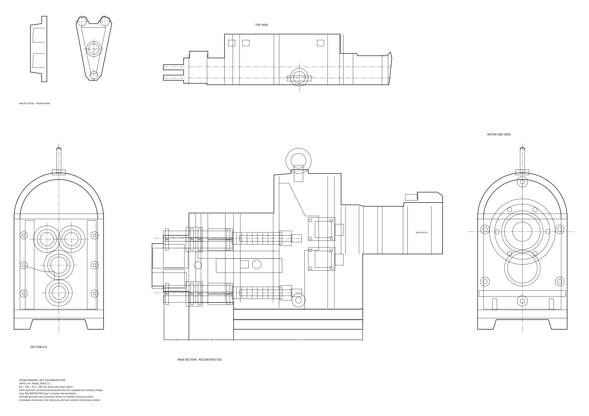

# 이미지 복원 DXF 도면

[DXF 파일 다운로드](https://github.com/ruddnr88/dxgcad/raw/refs/heads/nwapp/assembly_review_1to1.dxf)

다운로드한 `assembly_review_1to1.dxf`를 AutoCAD에서 열어 확인하세요. 파일 페이지에서는 **Download raw file** 버튼을 사용할 수 있습니다.

- AutoCAD R2010 DXF, 단위 mm, 모델 공간 1:1.
- `OUTLINE`: 외형선 / `CENTER`: 중심선 / `DIMENSION`: 치수선.
- `RECONSTRUCTED`: 비례 복원 내부선 / `NOTES`: 주기.
- 주 단면 하부에 60, 108, 312 mm 치수를 적용했습니다. 합계 480 mm입니다.
- 다른 형상은 첨부 이미지의 비례를 기준으로 수동 재구성한 **검토용**입니다. 판독 불가 치수와 공차는 확정하지 않았습니다.
- DXF 재읽기 및 구조 검사 오류 0건. 실제 AutoCAD 실행 검증은 하지 않았습니다.
